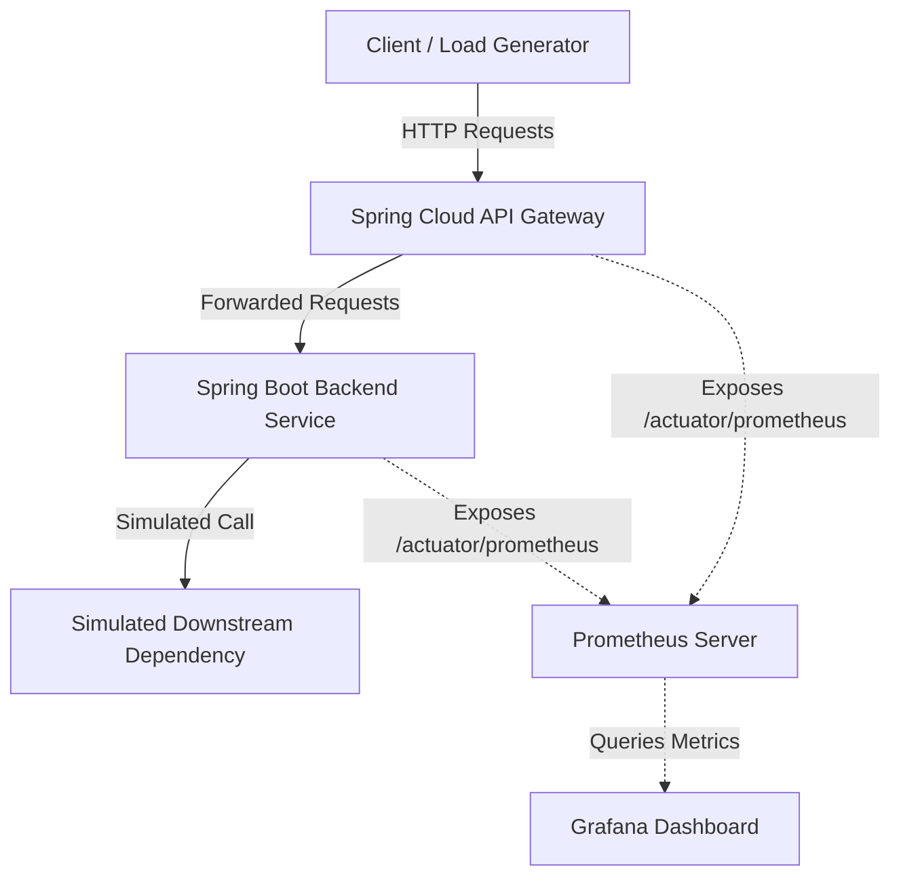
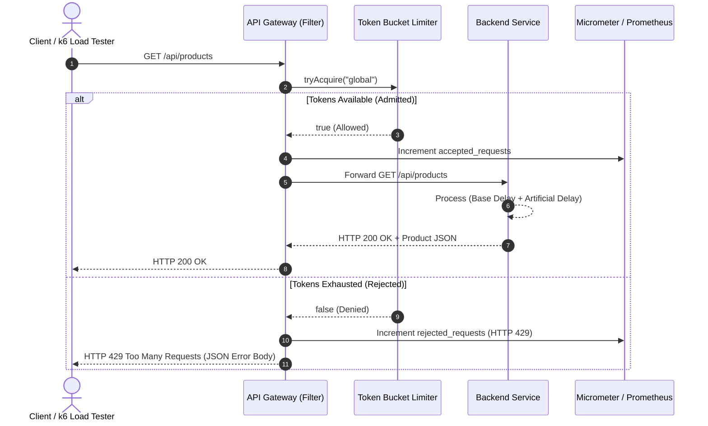
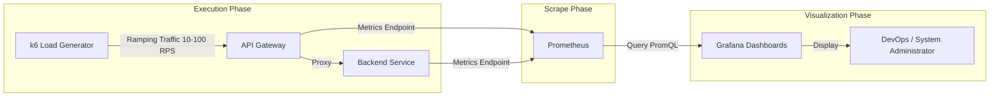

# Technical Architecture Specification
> **Project:** Adaptive Traffic Management System Using Dynamic Rate Limiting  
> **Document Scope:** System Context, Component Architecture, Request Flows, and Observability Pipeline

---

## 1. System Context

The Adaptive Traffic Management System sits at the perimeter of a microservices cloud environment. Clients and load generators issue HTTP requests to the **API Gateway**, which routes accepted traffic to internal **Backend Services**.

---

## 2. Component Architecture

### A. API Gateway (`gateway/`)
- **Technology**: Spring Cloud Gateway (Netty, WebFlux)
- **Role**: Entry point, traffic filtering, metrics generation, baseline static rate limiting.
- **Key Modules**:
  - `StaticTokenBucketRateLimiter`: Thread-safe token bucket holding static RPS capacity.
  - `StaticRateLimiterGatewayFilterFactory`: Intercepts request pipeline, evaluates capacity, updates Micrometer metrics, and returns HTTP 429 when capacity is exhausted.
  - `RateLimiterStrategy`: Pluggable abstraction allowing seamless dynamic replacement in future adaptive controller milestones.

### B. Backend Service (`backend/`)
- **Technology**: Spring Boot 3.2.x (Embedded Tomcat, Web MVC)
- **Role**: Simulates domain operations (`/api/products`, `/api/orders`, `/api/health`).
- **Key Modules**:
  - `DelaySimulationService`: Controls baseline endpoint latencies and artificial downstream delays (`SIMULATED_DELAY_MS`).
  - `ProductController` / `OrderController` / `HealthController`: Expose REST endpoints returning JSON responses.

### C. Monitoring Pipeline (`monitoring/`)
- **Prometheus**: Periodically scrapes `/actuator/prometheus` on Gateway and Backend.
- **Grafana**: Visualizes real-time request rates, latency curves (p50/p95), and HTTP 429 rejections.

---

## 3. Request Flow Pipeline

---

## 4. Gateway Responsibilities
1. **Single Entry Point**: Standardizes incoming routing (`/api/**`).
2. **Static Baseline Rate Limiting**: Ensures total admitted traffic per second does not exceed `STATIC_REQUEST_LIMIT`.
3. **Graceful Rejection Handling**: Formats standard HTTP 429 JSON responses without throwing unhandled exceptions.
4. **Perimeter Observability**: Emits custom counters and gauges for total, accepted, and rejected traffic.

---

## 5. Backend Responsibilities
1. **Business Service Simulation**: Handles product, order, and health requests.
2. **Artificial Delay Injection**: Simulates downstream database or third-party service latency via `SIMULATED_DELAY_MS`.
3. **Internal Metrics**: Exposes thread activity, memory, and HTTP response metrics via Spring Boot Actuator.

---

## 6. Monitoring & Load Testing Flow

