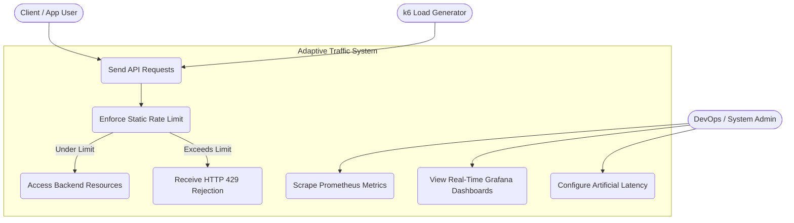
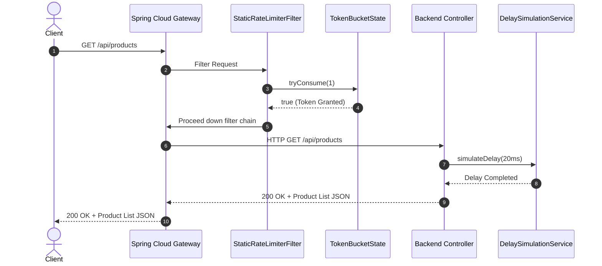
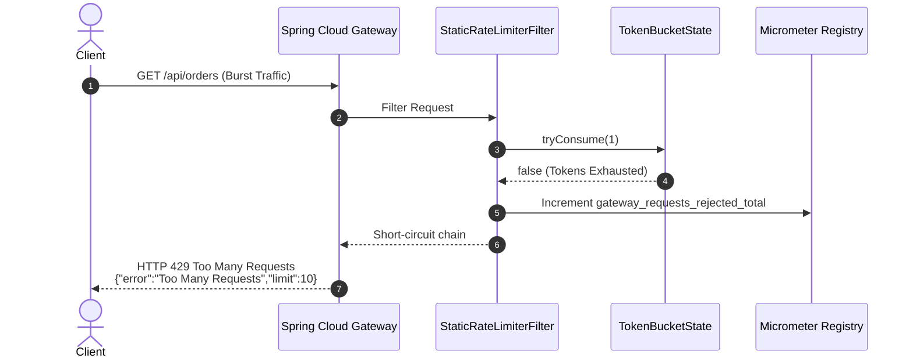

# Software Modelling & DevOps Specifications
> **Project:** Adaptive Traffic Management System Using Dynamic Rate Limiting  
> **Course Scope:** B.Tech Software Modelling and DevOps Capstone (First 20% Milestone)

---

## 1. Use Case Diagram

The Use Case Diagram depicts the interaction between external actors (Clients, Load Testing System, System Administrator) and the core capabilities provided by the Gateway and Monitoring infrastructure.



---

## 2. Component Diagram

The Component Diagram shows the high-level software components, interfaces, and dependencies within the system.

```mermaid
componentDiagram
    package "Client Environment" {
        [k6 Load Tester] as LoadGen
    }

    package "API Gateway Container (:8080)" {
        [Routing Engine] as Router
        [Static Rate Limiter Filter] as RateFilter
        [Token Bucket Limiter] as TokenBucket
        [Gateway Metrics Collector] as GWMetrics
    }

    package "Backend Service Container (:8081)" {
        [Product Controller] as ProdCtrl
        [Order Controller] as OrderCtrl
        [Health Controller] as HealthCtrl
        [Delay Simulation Service] as DelaySvc
        [Backend Metrics Collector] as PEMetrics
    }

    package "Monitoring Stack" {
        [Prometheus Scraper (:9090)] as Prom
        [Grafana Engine (:3000)] as Grafana
    }

    LoadGen --> Router : HTTP /api/*
    Router --> RateFilter
    RateFilter --> TokenBucket : tryAcquire()
    RateFilter --> GWMetrics : Record Accepted/Rejected
    RateFilter --> ProdCtrl : HTTP Proxy /api/products
    RateFilter --> OrderCtrl : HTTP Proxy /api/orders
    RateFilter --> HealthCtrl : HTTP Proxy /api/health

    ProdCtrl --> DelaySvc
    OrderCtrl --> DelaySvc
    HealthCtrl --> DelaySvc

    Prom --> GWMetrics : /actuator/prometheus
    Prom --> PEMetrics : /actuator/prometheus
    Grafana --> Prom : PromQL Queries
```

---

## 3. Deployment Diagram

The Deployment Diagram details the node allocation, Docker containers, network protocols, and exposed ports in the containerized deployment environment.

```mermaid
nodeDiagram
    node "Host Machine / Docker Engine" {
        node "Bridge Network: capstone-network" {
            
            node "Docker Container: capstone-gateway" {
                artifact "gateway-1.0.0.jar" as GWJar
                portIn "8080" as GWPort
            }

            node "Docker Container: capstone-backend" {
                artifact "backend-1.0.0.jar" as BEJar
                portIn "8081" as BEPort
            }

            node "Docker Container: capstone-prometheus" {
                artifact "Prometheus v2.51" as PromArt
                portIn "9090" as PromPort
            }

            node "Docker Container: capstone-grafana" {
                artifact "Grafana v10.4" as GrafArt
                portIn "3000" as GrafPort
            }
        }
    }

    GWPort --> BEPort : HTTP / Internal Docker Routing
    PromPort --> GWPort : Scrape /actuator/prometheus
    PromPort --> BEPort : Scrape /actuator/prometheus
    GrafPort --> PromPort : PromQL HTTP API
```

---

## 4. Sequence Diagram: Normal Request (Accepted - HTTP 200)

This sequence diagram models the execution flow for a request admitted within the configured static rate limit.



---

## 5. Sequence Diagram: Rate-Limited Request (Rejected - HTTP 429)

This sequence diagram models the execution flow when traffic exceeds the static limit, triggering rate limiter rejection.


